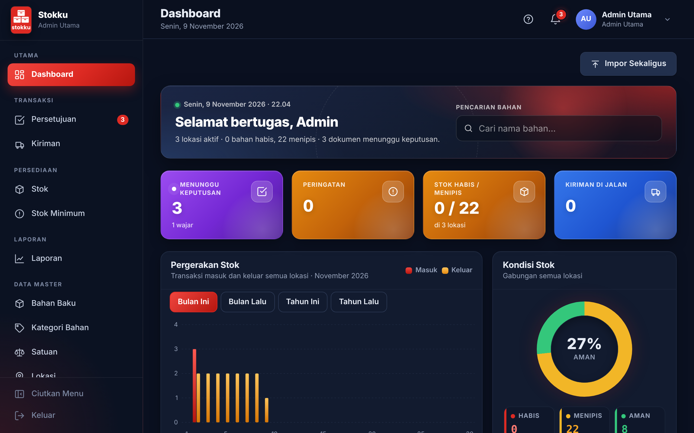
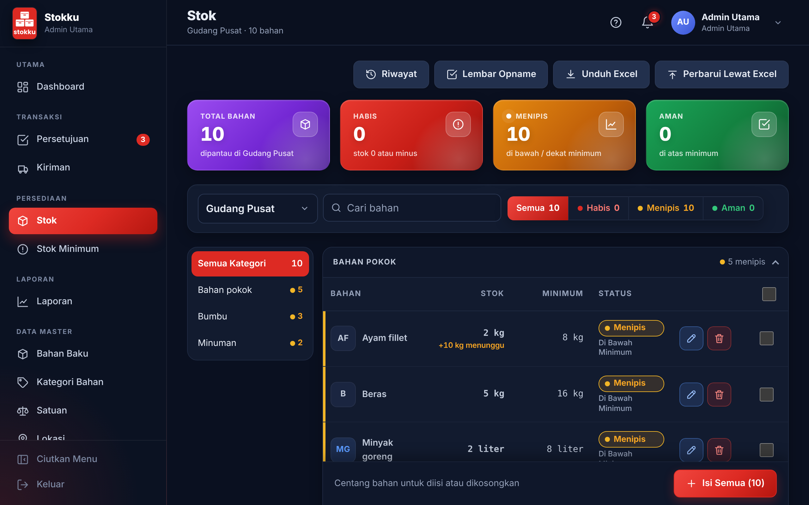
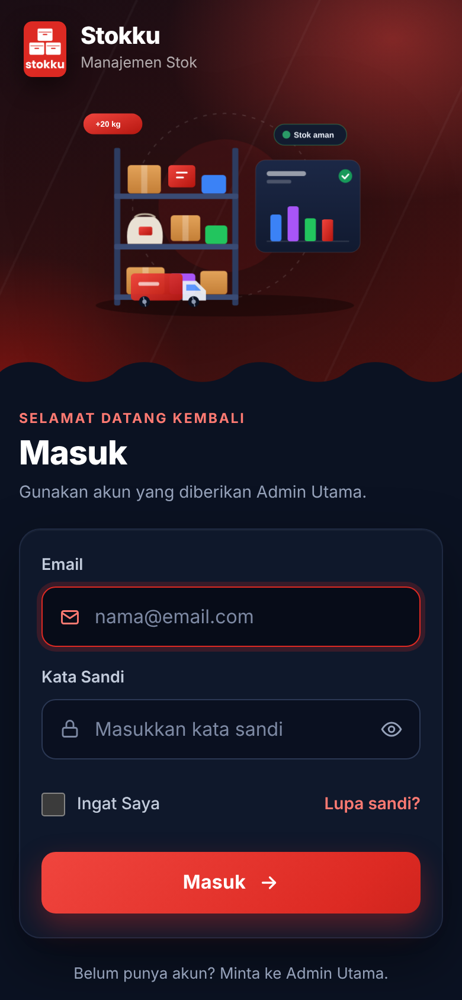
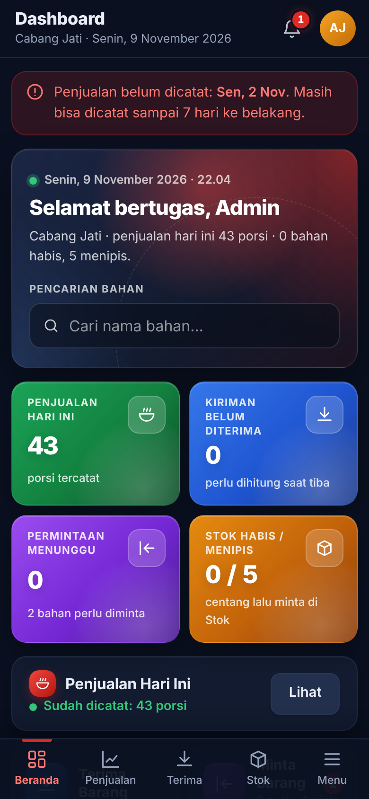
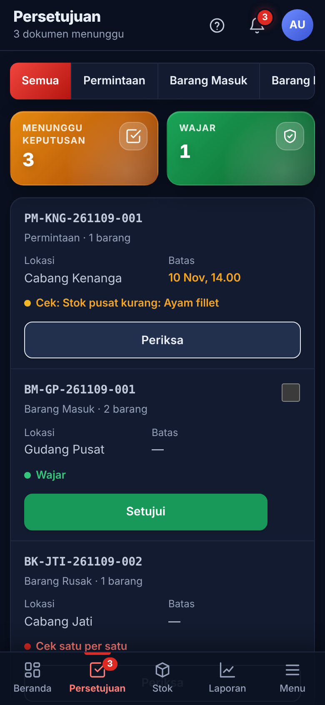

# Stokku

Aplikasi web manajemen stok bahan baku untuk usaha kuliner dengan **satu gudang pusat dan banyak cabang**.
Mencatat barang masuk dari supplier, permintaan cabang, persetujuan, kiriman, barang rusak, stock opname, dan
penjualan harian, lalu memakai resep menu untuk mendeteksi selisih, kecurangan, dan pemborosan bahan sedini mungkin.
Tampilan dirancang untuk HP lebih dulu (mobile-first) dan bisa dipasang sebagai aplikasi (PWA).

> **English summary.** Stokku is a mobile-first inventory system for multi-branch F&B businesses, built with
> Laravel 12. It covers the whole flow from supplier purchases to central-warehouse approval, branch requests,
> blind-count deliveries, stock opname, daily sales with recipe-based consumption, Excel import/export with typo
> detection, PDF documents, dashboards, and a nightly email report. 543 automated tests.

Dikembangkan untuk usaha kuliner yang sedang berjalan. Repositori publik ini memakai nama, logo, dan data contoh;
identitas usaha aslinya tidak disertakan.

| | |
|---|---|
|  |  |

| Masuk | Dashboard cabang | Persetujuan |
|---|---|---|
|  |  |  |

## Fitur utama

- **Tiga peran** dengan menu dan hak akses berbeda: Admin Utama, Admin Pusat (gudang), Admin Cabang.
- **Alur barang lengkap**: barang masuk → persetujuan → kiriman ke cabang → penerimaan buta (cabang menghitung
  tanpa melihat jumlah kiriman) → penjualan harian yang memotong stok sesuai resep.
- **Permintaan otomatis** untuk bahan cabang yang di bawah minimum, dan **tolak otomatis** bila melewati batas waktu.
- **Stock opname** dengan stok dikunci selama penghitungan; selisih dinilai wajar/tidak terhadap toleransi bahan.
- **Peringatan dini** dan **lampu stok** (habis, menipis, aman) per lokasi dan per kategori.
- **Impor Excel universal**: kolom dikenali dari banyak sinonim, salah ketik ditanyakan ("Maksudnya …?"),
  jumlah pintar (`2x10 kg`, `500 gram`), pratinjau sebelum disimpan; templat Excel siap isi untuk tiap data.
- **Ekspor Excel dan PDF**: laporan, dokumen transaksi, riwayat stok per hari.
- **Email laporan harian pukul 23.59** per akun: pilih isi laporan sesuai peran, banyak alamat tujuan, lampiran Excel.
- **Dashboard dan grafik** pergerakan stok, kondisi stok, dan penjualan.
- **Pembaruan otomatis** tanpa WebSocket (cocok untuk shared hosting) dan **PWA** yang bisa dipasang di HP.
- **Pengaturan** angka aturan, identitas usaha (nama dan logo bisa diganti), saklar fitur, hak akses per peran,
  periode buku, dan log perubahan.

## Teknologi

- **Laravel 12**, PHP 8.2, MySQL / MariaDB
- Blade, **Tailwind CSS v4**, Vite, JavaScript tanpa framework
- **PhpSpreadsheet** untuk Excel; pembuat PDF sendiri (tanpa pustaka PDF eksternal)
- PHPUnit: 543 pengujian otomatis (84 berkas pengujian fitur)

## Arsitektur singkat

- Semua perubahan stok lewat satu pintu, `App\Services\StokService`, di dalam `DB::transaction()` dengan
  `lockForUpdate()`. Setiap perubahan tercatat di buku besar `stok_mutasi` (tidak pernah diubah atau dihapus);
  saldo terkini di `stok_saldo`.
- Logika bisnis di `app/Services`, validasi di `app/Http/Requests`, controller tipis per peran.
- Data master yang sudah dipakai transaksi hanya dinonaktifkan, tidak dihapus.
- Resep berversi menurut tanggal berlaku; penjualan menyalin resep yang berlaku di tanggalnya.

```
app/Services                     logika bisnis (Stok, Permintaan, Persetujuan, Kiriman, Opname, Penjualan, Laporan, Impor/Ekspor)
app/Http/Controllers/{AdminUtama,Pusat,Cabang}  controller per peran
app/Http/Requests                validasi form
app/Models                       model Eloquent
app/Support                      format angka Indonesia, nomor dokumen, pembaca jumlah pintar
resources/views/components       komponen Blade
tests/Feature                    pengujian otomatis per modul
```

## Menjalankan di komputer sendiri

Kebutuhan: PHP 8.2+ (ekstensi `zip` dan `gd`), Composer 2, MySQL/MariaDB, Node.js 20+.

```bash
git clone https://github.com/evantralala/stokku.git
cd stokku
composer install
npm install
cp .env.example .env
php artisan key:generate
```

Buat database kosong `stokku`, sesuaikan `DB_*` di `.env`, isi `ADMIN_UTAMA_PASSWORD` (minimal 8 karakter), lalu:

```bash
php artisan migrate --seed
npm run build
php artisan serve
```

Buka `http://localhost:8000` dan masuk dengan `ADMIN_UTAMA_EMAIL` dari `.env`. Seeder hanya membuat akun Admin Utama
dan pengaturan bawaan; lokasi, bahan, menu, dan pengguna lain diisi lewat aplikasi atau templat Excel.

Tugas terjadwal (permintaan otomatis, tolak otomatis, email laporan) berjalan lewat `php artisan schedule:work`
di lokal atau cron `schedule:run` tiap menit di server.

```bash
php artisan test
```

Panduan memasang di shared hosting ada di [docs/panduan-hosting.md](docs/panduan-hosting.md).

## Pembuat

Dibuat oleh **[evantralala](https://github.com/evantralala)** sebagai proyek magang, dengan bantuan asisten AI
Claude (Anthropic) untuk penulisan kode dan pengujian.
